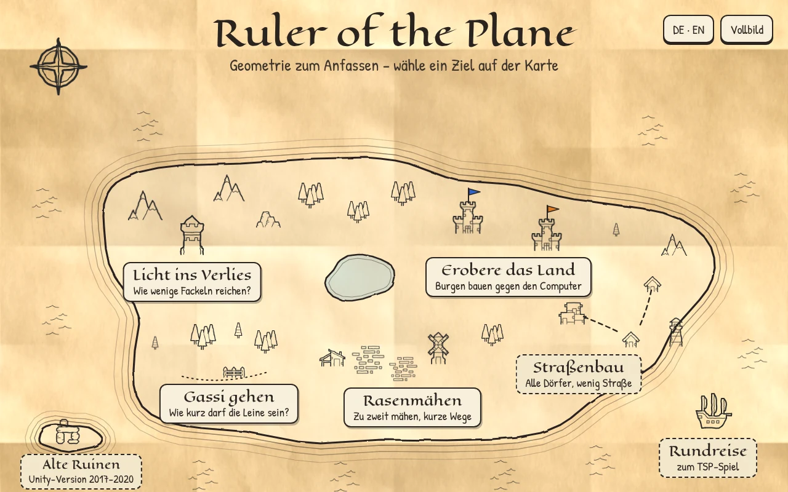

# Ruler of the Plane

Spiele zur algorithmischen Geometrie für den Tag der offenen Tür der TU Dortmund. Browser games that make
computational geometry tangible, for walk-up visitors and for playing at home.

**Status:** work in progress for the open house on 7 November 2026. Once Phase 0 of the roadmap is done,
the current version runs at <https://ls11ae.github.io/ruler-of-the-plane/>.

Booth edition:

- **Licht ins Verlies**: light a dungeon with as few torches as possible (art gallery problem).
- **Erobere das Land**: build castles against the computer (Voronoi game with land, water and cities).
- **Gassi gehen**: walk the dog on the shortest leash (Fréchet distance, with free-space diagram).
- **Rasenmähen**: mow a lawn with two cutters (CG:SHOP 2027 lawn mowing).
- **Straßenbau** (optional): connect all villages with as little road as possible (minimum spanning tree).

The TSP game lives in the separate project tsp-boards. The original Unity version (TU Eindhoven,
2017–2020) is at [github.com/kbuchin/ruler](https://github.com/kbuchin/ruler) and still playable at
[kbuchin.github.io/ruler](https://kbuchin.github.io/ruler/).



## Development

Requirements: Node 22.13 or newer and npm. After Phase 0 of [`docs/roadmap.md`](docs/roadmap.md):

```sh
npm install
npm run dev     # development server
npm run check   # format check, lint, typecheck, tests, build
```

Most of the work happens in Claude Code on the web: see [`CLAUDE.md`](CLAUDE.md) and
[`docs/cloud-sessions.md`](docs/cloud-sessions.md).

## Licence and credits

The code is licensed under the MIT licence ([`LICENSE`](LICENSE)). The art (Kenney, CC0) and the fonts
(Eagle Lake and Patrick Hand, SIL Open Font License 1.1) keep their own licences. The level files in
`legacy/` and the level data generated from them come from the Unity version and are not covered by the
MIT licence (see [`legacy/README.md`](legacy/README.md)). Details in [`CREDITS.md`](CREDITS.md).
